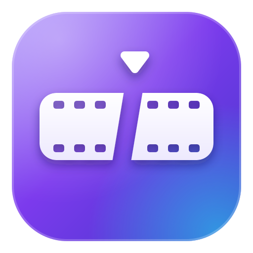
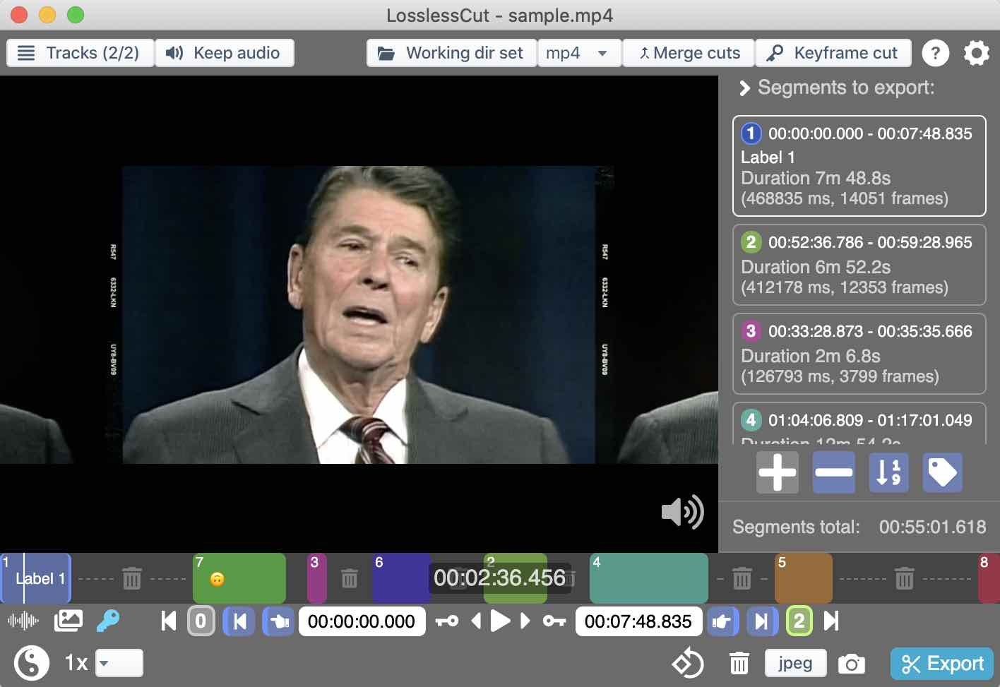
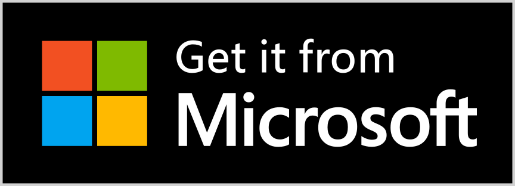

	 
  

  
<a href="https://losslesscut.app/"><b>LosslessCut</b></a>

  The swiss army knife of lossless video/audio editing
	 
  
        
	 
	 
  <a href="https://mifi.no/thanks/">Thanks to my supporters</a> and everyone who purchased LosslessCut!
	 
	 
  

	 
	 

LosslessCut aims to be the ultimate cross platform FFmpeg GUI for extremely fast and lossless operations on video, audio, subtitle and other related media files.
The main feature is lossless trimming and cutting of video and audio files, which is great for saving space by rough-cutting your large video files taken from a video camera, GoPro, drone, etc. It lets you quickly extract the good parts from your videos and discard many gigabytes of data without doing a slow re-encode and thereby losing quality. There are also many more [use cases](https://losslesscut.app/docs/features#example-use-cases). Everything is extremely fast because it does an almost direct data copy, fueled by the awesome FFmpeg which does all the grunt work.

## Table of contents

- [Features](#features)
- [Download](#download)
- [Supported formats](#supported-formats)
- [Documentation, usage & getting started](#documentation)
- [Video demos](#video-demos)
- [Featured](#featured)
- [Attributions](#attributions)

## Features

<!-- Highlights only, the full list is docs/features.md. Keep in sync with the homepage's (website/src/components/Home.tsx) -->
- Cut and trim video and audio losslessly, in seconds
- Merge cut segments, or whole files with identical codecs, losslessly
- Add, remove, replace or extract tracks: audio, subtitles and more
- Change the format (remux), for example from MKV to MP4, without re-encoding
- Segments, markers and tags, with import/export of chapters, CSV, EDL and more
- Detect scenes, black frames and silence, and split by them
- Edit metadata and rotation, and create chapters
- Opens almost any format, even ones your player can't play
- Snapshots and frame export, keyboard shortcuts, a [CLI](https://losslesscut.app/docs/cli) and an [HTTP API](https://losslesscut.app/docs/api)

**[All features and example use cases →](https://losslesscut.app/docs/features)**

See also the [Recipe cookbook](https://losslesscut.app/docs/recipes).

## Download

If you want to support my continued work on LosslessCut, and you want the advantage of a secure and simple installation process with automatic, stable updates, consider getting it from your favorite store:

 

For Linux I publish to the Snap Store:

If you prefer to download the executables manually, this will of course always be free (see also [supported operating systems](https://losslesscut.app/docs/requirements)):

- macOS: [Intel](https://github.com/mifi/lossless-cut/releases/latest/download/LosslessCut-mac-x64.dmg) / [Apple Silicon](https://github.com/mifi/lossless-cut/releases/latest/download/LosslessCut-mac-arm64.dmg) DMG (note that PKG does **not** work)
- Windows: [7zip](https://github.com/mifi/lossless-cut/releases/latest/download/LosslessCut-win-x64.7z) (Windows 7, 8 and 8.1 is [no longer supported after v3.50.0](https://losslesscut.app/docs/requirements))
- Linux: [x64 tar.bz2](https://github.com/mifi/lossless-cut/releases/latest/download/LosslessCut-linux-x64.tar.bz2) / [x64 AppImage](https://github.com/mifi/lossless-cut/releases/latest/download/LosslessCut-linux-x86_64.AppImage) / [arm64 tar.bz2](https://github.com/mifi/lossless-cut/releases/latest/download/LosslessCut-linux-arm64.tar.bz2) / [Raspberry Pi armv7l](https://github.com/mifi/lossless-cut/releases/latest/download/LosslessCut-linux-armv7l.tar.bz2) (armv7l doesn't include FFmpeg)
- [More releases](https://github.com/mifi/lossless-cut/releases) - Note that APPX (Windows) and PKG (macOS) do **not** work
- [Latest nightly builds 🧪](https://mifi.no/llc/nightly/)

Note that the above are the [only official downloads](https://losslesscut.app/docs#faq). There are also unofficial releases like [Flathub](https://flathub.org/apps/details/no.mifi.losslesscut) (not maintained by me). Difference between App Stores and GitHub download? [Please see FAQ](https://losslesscut.app/docs#faq).

LosslessCut is maintained by me alone and will always remain free and open source. If it's useful to you, consider supporting my work. Alternatively [donate to the FFmpeg team](https://www.ffmpeg.org/donations.html) because they are doing the world a huge favor.

[Paypal](https://paypal.me/mifino/usd) | [crypto](https://mifi.no/thanks) | [more](https://mifi.no/thanks)

## Supported formats

LosslessCut uses the Chromium browser's HTML5 video player, and not all formats/codecs are [natively supported](https://www.chromium.org/audio-video). Generally, the following file formats work: `MP4`, `MOV`, `WebM`, `Matroska`, `OGG` and `WAV`. Audio codecs: `FLAC`, `MP3`, `Opus`, `PCM`, `Vorbis` and `AAC`. Video codecs: `H264`, `AV1`, `Theora`, `VP8`, `VP9` and `H265` (with hardware decoder). Learn the [difference between a codec and a format](https://losslesscut.app/docs#primer-videoaudio-codecs-vs-formats). Files with other codecs and formats are played through FFmpeg instead (*FFmpeg-assisted playback*), automatically when LosslessCut knows they're unsupported, or from `File` → *Convert to supported format*. The export is still done from the original file, so it's still lossless. This means you can open almost any file that FFmpeg can decode.

## Documentation

- Official website: [LosslessCut.app](https://losslesscut.app)
- **[Getting started, FAQ and usage documentation](https://losslesscut.app/docs)**
- [Troubleshooting and known issues and limitations](https://losslesscut.app/docs/troubleshooting)
- [Contributing](CONTRIBUTING.md)

### Video demos

- [Common features](https://www.youtube.com/watch?v=pYHMxXy05Jg)
- [How to add a thumbnail / cover art to an MP4](https://www.youtube.com/watch?v=4pYJ93cn80E)
- [How to add multi-language audio to a video](https://www.youtube.com/watch?v=MRBGDsuw_WU)
- Your video here?

## Featured

- [Console newsletter](https://console.substack.com/p/console-93)
- Hacker News [2024](https://news.ycombinator.com/item?id=40829494) [2022](https://news.ycombinator.com/item?id=33969490) [2020-10](https://news.ycombinator.com/item?id=24883030) [2020-01](https://news.ycombinator.com/item?id=22026412) [2016](https://news.ycombinator.com/item?id=12885585)
- [Wikipedia](https://en.m.wikipedia.org/wiki/LosslessCut)
- Your link here?
- theo (YouTube) [1](https://youtu.be/FI5ba4RRE8U?t=246) [2](https://youtu.be/uaCypXEJjes?t=381)

## Attributions
- App icon made by [Dimi Kazak](http://www.flaticon.com/authors/dimi-kazak "Dimi Kazak") from [www.flaticon.com](http://www.flaticon.com "Flaticon") is licensed by [CC 3.0 BY](http://creativecommons.org/licenses/by/3.0/ "Creative Commons BY 3.0").
- [Lottie animation by Chris Gannon](https://lottiefiles.com/7077-magic-flow).
- Thanks to Adi Abinun and [@abdul-alhasany](https://github.com/mifi/lossless-cut/issues/2561) for UI work.
- Thanks to translators who helped translate the app. [You can too!](https://losslesscut.app/docs/translation)
- [Thanks to everyone for supporting](https://mifi.no/thanks/) my open source work 🙌

---

Made with ❤️ in [🇳🇴](https://www.youtube.com/watch?v=uQIv8Vo9_Jc)

[More apps by mifi.no](https://mifi.no/)

Follow me on [GitHub](https://github.com/mifi/), [YouTube](https://www.youtube.com/channel/UC6XlvVH63g0H54HSJubURQA), [IG](https://www.instagram.com/mifi.no/), [Twitter](https://twitter.com/mifi_no) for more awesome content!
